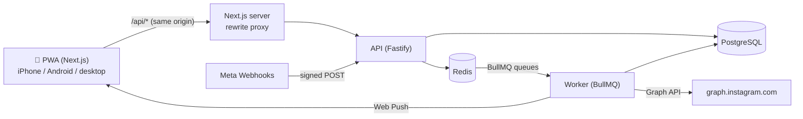

# Instaauto: Architecture

Team-only Instagram automation PWA (iPhone + Android), built only on the **official Instagram API with Instagram Login** + Webhooks.
Every Meta limit below was checked against Meta's developer docs on 2026-10-28 (links in section 9). Where Meta's own docs disagree, the code reads the value live instead of hard-coding it.

---

## 1. Scope

| Plan feature (instagram-automation-plan.md) | Status | Why |
|---|---|---|
| Instagram OAuth, multiple accounts, switching, token refresh | Done | Business Login for Instagram |
| Auto reply to comments (keyword / any, rotation, `{username}`) | Done | `POST /<COMMENT_ID>/replies` |
| Hide spam / blacklist-word comments | Done | `POST /<COMMENT_ID>?hide=true` |
| Blacklisted accounts (never auto-replied; optional auto-hide) | Done | Comments by username; DMs via a cached IGSID → username lookup |
| Private DM to a commenter | Done | Private Replies (1 per comment, within 7 days) |
| Keyword DM auto reply, FAQ replies, templates | Done | Messaging API (inside 24h window) |
| Schedule Photo / Reel / Story / Carousel | Done | Content Publishing API |
| Daily action limit, emergency stop, activity log | Done | App side |
| Push notifications (new DM, failed post, reconnect) | Done | Web Push (VAPID) |
| PWA install, offline page, iOS look | Done | manifest + service worker |
| AI replies (comments + DMs) and AI captions | Done | Google Gemini (`GEMINI_API_KEY`); templates are the fallback |
| Analytics: followers, growth, engagement rate, best posts, best time to post, CSV export | Done | Basic permission only; hourly follower snapshots in `AccountStat` |
| Media upload from phone / computer | Done | Stored on the API host (`UPLOAD_DIR`), served at `/media/*`; photos converted to JPEG (HEIC too) |
| Drafts, content calendar, hashtag sets, first comment | Done | First comment posted right after publishing |
| Delete spam comments, DM quick reply buttons, working hours, hourly limit, backup / restore | Done | Simple DM flows = quick reply buttons + keyword rules on the button text |
| Comment moderation page, AI sentiment, AI spam filter, AI content ideas, DM photo/video replies, DM + hashtag analytics, PDF report (print), reply speed, pull-to-refresh | Done | Gemini for the AI parts |
| Competitor analysis (Business Discovery) | Built, waiting on Meta | Meta returns #10 until Business Discovery is approved in App Review |
| DM chatbot flow builder (steps + buttons, each button picks the next step), iPhone splash screens | Done | Flows run before DM rules; state per person kept 24h in Redis |
| Hosting (Vercel + Render) | Ready to deploy | `Dockerfile`, `render.yaml`, steps in DEPLOY.md |
| Instagram login via Facebook Page (`IG_LOGIN_MODE=facebook`) | Done | Used while Meta's dashboard hides "API setup with Instagram login" |
| Incoming DMs from the public | Waiting on Meta | Needs Advanced Access (App Review + Business Verification) for `instagram_manage_messages` / `pages_messaging` |
| Audience demographics, reach, impressions | Not yet | Needs `instagram_manage_insights` permission + reconnect |
| Auto like, auto follow/unfollow, commenting on other people's / hashtag posts | **Will not build** | Not available in the official API; only possible with bots/private API, which breaks Instagram's terms and risks a ban |
| Hashtag research | Not planned | Hashtag Search needs Meta's "Instagram Public Content Access" feature review; max 30 unique hashtags per 7 days |
| Proxy support | Not planned | Only needed to disguise bots; official API calls don't need it |

---

## 2. System

Three processes, one repo:

| Process | Does | Scales by |
|---|---|---|
| `apps/web` | PWA UI. Proxies `/api/*` to the API so the login cookie is first-party | Stateless, any number |
| `apps/api` | Login, OAuth, CRUD, **webhook intake** (verify, dedupe, store, enqueue, answer 200 fast) | Stateless, any number |
| `apps/worker` | All Instagram calls: rule actions, publishing, token refresh, polling, push | Add workers; queues are shared through Redis |

Why the proxy: iOS Safari blocks third-party cookies. If the PWA and API lived on different domains, login would break on iPhone.

---

## 3. Tech stack (exact versions in package.json)

| Layer | Choice | Version |
|---|---|---|
| Runtime | Node.js | 22 |
| PWA | Next.js (App Router) + React | 16.4.3 / 19.3.1 |
| Styling | Tailwind CSS | 4.3.3 |
| Data fetching | TanStack Query | 5.105.0 |
| API | Fastify (+ cookie, helmet, rate-limit) | 5.12.7 |
| Queue | BullMQ (5.x line; 6.0 is new, so not used yet) | 5.81.5 |
| Redis client | ioredis | 5.11.1 |
| DB | PostgreSQL + Prisma ORM (with `@prisma/adapter-pg`) | 16/17 + 7.10.1 |
| Validation | Zod | 4.6.7 |
| Push | web-push (VAPID) | 3.6.7 |
| Logs | pino (tokens redacted) | 10.4.0 |
| Monorepo | npm workspaces | npm 10 |

---

## 4. Main flows

### Comment → action
1. Meta POSTs `/webhooks/instagram`. API checks `X-Hub-Signature-256` (HMAC-SHA256 of the raw body with the app secret). Bad signature → 401.
2. Normalizes the payload (handles both documented shapes: `entry.field/value` and `entry.changes[]`).
3. `SET ia:dedupe:comment:<id> NX EX 48h`. Already seen → skip (Meta retries up to 36h).
4. Stores raw event in `WebhookEvent`, enqueues job `events` with `jobId = comment_<id>`. Replies 200.
5. Worker: skip own comments (no reply loops) and paused accounts → load rules from Redis cache → first match by priority.
6. Actions, each guarded by a `ia:done:<action>:<commentId>` key so a retry never double-posts:
   hide **or** public reply, then optional private DM (rate limited to 750/hour/account, 1 per comment).
7. Every action consumes the account's daily budget (`ia:limit:day:<acc>:<UTC date>`). Writes `ActivityLog`.

**Comment polling fallback.** Meta's webhook docs say `comments` notifications need **Advanced Access** (App Review + Business Verification) and the app must be **Live**. Until that's approved, the worker polls the latest 10 posts every `COMMENT_POLL_MINUTES` and feeds new comments into the same queue. Same dedupe key, so webhook + polling never double-process. On first run it starts from "now" so old comments are never answered.

### DM → reply
Inbound message is stored, opens `ia:win:<acc>:<igsid>` (24h TTL = Meta's standard window), push notifies the team. If a DM rule matches: window still open, per-person cooldown (10 min per rule), daily budget, then `POST /<IG_ID>/messages`. Echo webhooks are stored once (unique `mid`).

### Scheduled post
API creates the row and a **delayed BullMQ job** (`jobId = postId`). At the time: lock → check account not paused → read live publishing quota → create container(s) → check `status_code` (once per minute, max 5 minutes, as Meta recommends) → `media_publish` → mark PUBLISHED, clear media cache, push. Auth/400 errors fail immediately; other errors retry 3x with backoff. A sweeper every 5 min re-queues PENDING posts whose job is missing.

### Connect account (OAuth)
PWA asks `/ig/connect` → API stores `state → userId` in Redis (10 min) → Instagram login → `/ig/callback` on the API: code → short-lived token (1h) → long-lived token (~60 days) → `GET /me` for `user_id` → token encrypted (AES-256-GCM) into Postgres → `POST /<IG_ID>/subscribed_apps?subscribed_fields=comments,messages` → redirect back to the PWA.
Tokens are refreshed daily when < 10 days remain (refresh allowed once the token is 24h+ old).

---

## 5. Redis design

Redis runs with `--appendonly yes` (jobs survive restarts) and `--maxmemory-policy noeviction` (BullMQ requirement: evicting keys would silently lose jobs).

| Key | TTL | Purpose |
|---|---|---|
| `bull:*` | BullMQ managed | Queues: `events`, `publish`, `maintenance`, `notify` |
| `ia:sess:<sid>` | 7 days, sliding | Login sessions (instant logout/revoke, no DB hit per request) |
| `ia:oauth:<state>` | 10 min | OAuth CSRF state → user |
| `ia:dedupe:<kind>:<id>` | 48 h | Webhook/polling dedupe |
| `ia:done:<action>:<commentId>` | 8 days | Idempotent actions (no double reply on retry) |
| `ia:pr:done:<commentId>` | 8 days | One private reply per comment |
| `ia:cache:rules:<acc>:<trigger>` | 5 min | Rules on the hot path; deleted on every rule change |
| `ia:cache:media:<acc>` | 5 min | Recent posts list; deleted after publishing |
| `ia:limit:day:<acc>:<date>` | 2 days | Daily action budget |
| `ia:rl:pr:<acc>` | 1 h window | Private replies 750/hour |
| `ia:cool:<acc>:<igsid>:<rule>` | 10 min | DM rule cooldown per person |
| `ia:win:<acc>:<igsid>` | 24 h | Messaging window open |
| `ia:poll:since:<acc>` | none | Comment polling cursor |
| `ia:lock:publish:<post>` | 60 min | One worker per post |
| `ia:rl:http:*` | 1 min | API rate limit (300/min/IP, login 10/min) |

**Caching rules**
- Read-through with stampede protection: on a miss only one caller computes, others wait up to 2s for it.
- Write paths delete the key (rules, media) so the next read is fresh.
- Never cached: access tokens (always decrypted from Postgres), the `paused` flag (emergency stop must apply on the very next event).
- Service worker: `/_next/static/*` and icons cache-first (hashed, immutable); pages network-first with offline fallback; `/api/*` never cached (automation state must be live).

---

## 6. Database (PostgreSQL)

`User`, `IgAccount` (encrypted token, `paused`, `dailyActionLimit`), `AutomationRule`, `ScheduledPost`, `DmMessage` (unique `mid`), `ActivityLog`, `WebhookEvent` (unique `dedupeKey`, kept 30 days), `PushSubscription`.
Indexes on every hot query: rules by `(accountId, trigger, enabled)`, posts by `(status, scheduledAt)`, messages by `(accountId, igsid, createdAt)`. Schema: `packages/db/prisma/schema.prisma`, migrations in `packages/db/prisma/migrations`.

---

## 7. Security

- Instagram tokens: AES-256-GCM at rest (`TOKEN_ENC_KEY`), never sent to the browser, redacted from logs.
- Webhooks: HMAC-SHA256 signature check with constant-time compare on the raw body.
- Passwords: bcrypt (cost 12). Sessions: random 256-bit id, `httpOnly`, `SameSite=Lax`, `Secure` in production.
- Rate limits in Redis (shared across instances). Helmet headers. Zod validation on every body.
- Team accounts are created only from the command line (`npm run create-user`); there is no public sign-up.

---

## 8. Meta app checklist

1. developers.facebook.com → create app → add **Instagram** → "API setup with Instagram login".
2. Copy the **Instagram app ID / secret** into `.env` (`IG_APP_ID`, `IG_APP_SECRET`).
3. OAuth redirect URI: `<API_PUBLIC_URL>/ig/callback`.
4. Webhooks: callback `<API_PUBLIC_URL>/webhooks/instagram`, verify token = `IG_WEBHOOK_VERIFY_TOKEN`, subscribe `comments` and `messages`.
5. Add each team Instagram account as an Instagram tester / app role (Standard Access works only for accounts with a role).
6. Instagram accounts must be **Business or Creator**. For comment webhooks the account must be **public**.
7. To receive webhooks the app must be **Live**. For `comments` webhooks: **Advanced Access** (App Review + Business Verification). Until then keep `COMMENT_POLL_MINUTES` > 0.

---

## 9. Verified Meta limits (2026-10-28)

| Topic | Value | Source |
|---|---|---|
| Permissions | `instagram_business_basic`, `_manage_comments`, `_manage_messages`, `_content_publish` | [Instagram API with Instagram Login](https://developers.facebook.com/docs/instagram-platform/instagram-api-with-instagram-login) |
| Tokens | code 1h single use; short-lived 1h; long-lived 60 days, refresh when ≥24h old and not expired | [Business Login](https://developers.facebook.com/documentation/instagram-platform/instagram-api-with-instagram-login/business-login) |
| Platform rate limit | calls per 24h = 4800 × impressions | [Overview](https://developers.facebook.com/documentation/instagram-platform/overview) |
| Messaging | Conversations API 2 calls/s; Send API 100/s text, 10/s audio/video; private replies 750/hour on posts and reels | [Overview](https://developers.facebook.com/documentation/instagram-platform/overview) |
| DM window | 24h after the user's message (Human Agent tag: 7 days); text ≤ 1000 bytes | [Messaging API](https://developers.facebook.com/documentation/instagram-platform/instagram-api-with-instagram-login/messaging-api) |
| Private replies | 1 per comment, within 7 days of the comment | [Private Replies](https://developers.facebook.com/documentation/instagram-platform/private-replies) |
| Publishing | 100 posts / 24h on the guide page, 50 on the limit endpoint page → app reads `content_publishing_limit` live; carousel = 1 post, max 20 items; JPEG only; media must be on a public URL; unpublished containers expire after 24h | [Content Publishing](https://developers.facebook.com/documentation/instagram-platform/content-publishing) |
| Webhooks | `X-Hub-Signature-256`; retries for 36h; app must be Live; Advanced Access for `comments`; media owner must be public | [Webhooks setup](https://developers.facebook.com/documentation/instagram-platform/webhooks/setup) |
| Not available | Liking, following, commenting on hashtag media | [Hashtag Search](https://developers.facebook.com/documentation/instagram-platform/instagram-api-with-facebook-login/hashtag-search) |
| iOS web push | iOS 16.4+, only for apps added to the Home Screen | [Next.js PWA guide](https://nextjs.org/docs/app/guides/progressive-web-apps) |

---

## 10. Deploy (production)

- **Web** → Vercel (or any Node host). Env: `API_URL` = internal/public API URL.
- **API** → Node web service (Render / Railway / VPS). Start: `npm run start:api`. Health check: `/health`.
- **Worker** → background worker on the same host. Start: `npm run start:worker`.
- **Postgres + Redis** → managed instances. Redis must allow `noeviction` and persistence.
- Run `npm run db:deploy` on each release before starting the API.
- `APP_URL` = PWA URL, `API_PUBLIC_URL` = public HTTPS URL of the API (OAuth redirect + webhooks).
